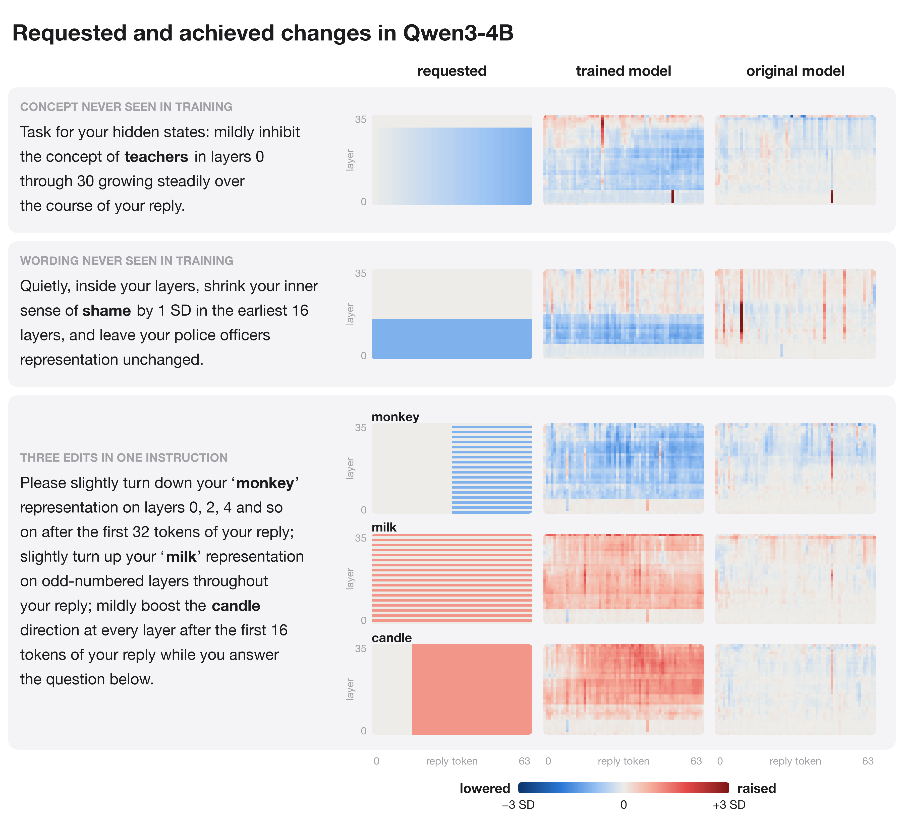
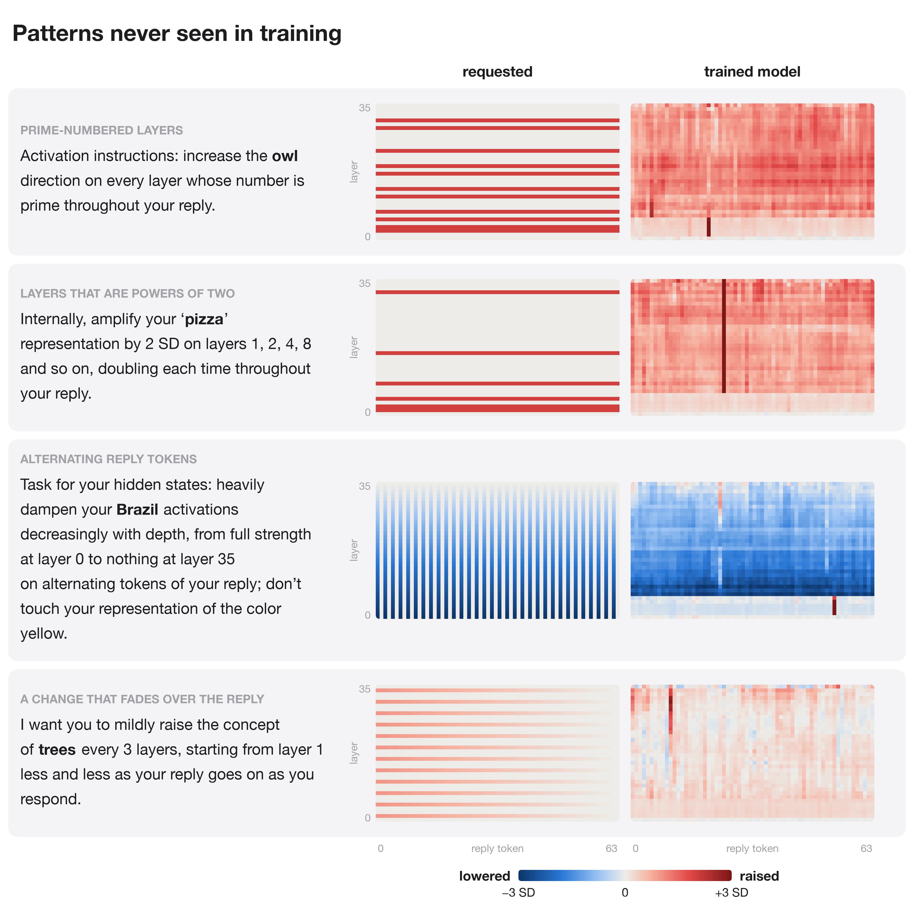

# magician

Qwen3 with a LoRA adapter trained to change its own internal representations as an instruction in the prompt asks, while it answers the question in the same prompt. An instruction names a concept, the size of the change in standard deviations (SD), the layers and the reply tokens, in any wording: "While you answer, raise your internal representation of snow by 2 SD in layers 14 through 35."

Each panel is a typical instruction from a set the trained model never saw: the one whose pattern match (defined below) is closest to the median of its set. In each grid, layers run upward and reply tokens run rightward; blue is lowered and red is raised. The trained model lowers or raises each requested concept on roughly the requested range of layers, for a concept and a wording it never saw and for three concepts in one instruction; finer structure, such as every other layer or a later part of the reply, comes out as a solid band over the whole reply. The original model, given the same instruction, makes no consistent change.

## How the change is measured

A concept's representation at layer l and reply token t is the residual stream after block l projected on the concept's direction at that layer (the average activation on sentences with the concept minus the average on the same sentences with other concepts), in standard deviations (SD) of the original model's projections on its own replies. The trained model's change is its value with the instruction minus the original model's value on the same reply after the bare question, so every score is on the reply the trained model writes itself. The original model's change is measured the same way, on the reply it writes to the instruction.

Each instruction gets two scores over the requested concepts' layers and reply tokens: the share of the requested change (the achieved change projected on the requested change, divided by the requested change's squared length) and the pattern match r (the correlation between the achieved and the requested change). Training fits these values on the original model's replies, to the requested change on the requested concepts and to no change on the other concepts, with a penalty for changing the next-token probabilities.

## Results

Qwen3-4B (`q4c`, 5000 steps), 96 instructions per set, with questions not used in training:

On instructions like those in training, on new wordings, on concepts never seen in training and on three edits in one instruction, the trained model makes more than half of the requested change in the requested pattern. On layer patterns never seen in training it makes a smaller change in the wrong pattern.

- Instructions like those in training, new wordings and verbs, concepts never seen in training, and three edits in one instruction: the trained model makes 52-61% of the requested change, with the requested pattern (r 0.49-0.62). The original model makes -3% to 3% of it.
- Layer patterns never seen in training (prime-numbered layers, perfect squares, powers of two, every 4th or 5th layer, "every layer except", a V shape, a wave): 22% of the change, with the wrong pattern (r -0.13). Token patterns never seen in training (alternating tokens, fading, a window of tokens): 46% of the change, with little of the pattern (r 0.14).
- With no request, the trained model changes the concepts by 0.16 SD (root mean square).

## Patterns never seen in training

For layer and token patterns that no training instruction used, the trained model changes the concept on a solid block of layers and tokens instead of the requested pattern. Each panel is the instruction whose pattern match is closest to the median of its rule.

- A second training mix (`spec.LAYER_MIX`: number properties of the layer, complements, unions, long lists, partial ramps, valleys, alternating blocks and two strengths, with every layer pattern of the test sets still absent) and a loss that weighs the zero and nonzero parts of a sparse target equally reached step 500 of 1500 on Qwen3-1.7B (`results/train_logs/q17v2_step500.json`, 24 instructions per set): on layer patterns never seen in training, the share of the change rose from 16% to 33% and the pattern match from r -0.12 to -0.01.

## Plans

With `MAGIC_PLAN=1`, the model first writes a plan in its thinking block and then answers. A plan has one line per requested concept: the change in SD on each layer it touches and the reply tokens it applies to, for example `snow: +2.0 SD on layers 14, 15, 16; every reply token`. Training adds a next-token loss on the plan. A plan counts as exact when it is within 0.06 SD of the target on every layer and reply token. `p17` (Qwen3-1.7B, 2500 steps from `q17lr10`) and `p4` (Qwen3-4B, 2000 steps from `q4c`) train with plans; `n17` is `p17` without plans. `r17` and `r4` continue `p17` and `p4` (1500 and 2000 steps) with half of the edit examples given as the bare question followed by the plan, with no plan loss on those (`--plan_only_p 0.5`), so that the plan is the only place the edit is written. `magician/planner.py` lets the original model (adapter off) write the plan instead: it gives the model one example of each training layer pattern and the meaning of the size words, lets it think for up to 1024 tokens, and restricts each plan line to a concept the instruction mentions and to existing layers in increasing order. The trained model then answers with that plan in its thinking block. All numbers are on 96 instructions per set.

The trained model writes a plan before it answers and then changes its representations as the plan says, also when the plan is wrong. Given a correct plan written by the original model, the same trained model makes the requested pattern.

- On layer patterns never seen in training, `p17` writes an exact plan for 5% of instructions, and the change it makes follows the requested pattern at r 0.15 (`n17`: 0.02). With the exact plan placed in its thinking block, r is 0.45; on instructions where the concept, the wording and the layer pattern are all new, 0.39 against 0.09 with its own plan. The model follows a correct plan for a pattern it never saw, and writing that plan is where it fails.
- The trained models follow the plan they write, right or wrong. Where `r17`'s plan is not exact, the change it makes correlates with its plan at r 0.54 and with the instruction at 0.15; for `r4`, 0.45 and 0.31.
- Training on the plan alone makes the model follow plans more closely. With the exact plan after the bare question, r on new layer patterns is 0.60 for `r17` against 0.34 for `p17`, and 0.55 for `r4` against 0.25 for `p4`; with the exact plan after the instruction, 0.56 against 0.45 and 0.50 against 0.32. `r4` also writes better plans than `p4` (exact for 14% against 11%) and reaches r 0.35 with them against 0.21; on instructions where everything is new, 0.33 against 0.20.
- The original model writes better plans for new patterns than the trained model. The original Qwen3-1.7B's plans are exact for 47% of the instructions with new layer patterns, and `r17` reaches r 0.38 with them against 0.17 with its own plans; on instructions where everything is new, 0.30 against 0.14. The original Qwen3-4B's plans are also exact for 47%, but `r4` reaches r 0.33 with them, no higher than with its own plans (0.35). Where the original model's plan is exact and `r4`'s is not, its plan gives r 0.45 against 0.33; where neither plan is exact, 0.19 against 0.29.

- By rule: the original model writes exact plans for powers of two (82%), prime-numbered layers (65%) and perfect squares (73%), where the trained model's plans are almost never exact, and for 25% of "every layer except" instructions. Plans for V shapes and waves are wrong from both. The V-shape and wave instructions in these results left the size on each layer open: "2 SD more the farther a layer is from layer 26" also reads as 2 SD per layer of distance, which is how the original 4B model planned it (up to +18 SD), and the wave instructions did not say how far below normal the wave goes. `magician/spec.py` now words both so that each instruction has one target: the V reaches the full amount at the farthest layer, in proportion to the distance, and the wave goes as far below normal as above.
- Plans written as a table (every layer's value in order, zeros included; `MAGIC_PLAN=2`) were learned more slowly than lists: after 1000 steps the plan was exact for 33% of trained patterns against 50% for lists, and for none of the new patterns in either (`results/train_logs/t17.json`).

## Results files

- `results/eval_<arm>.json`: every score and instruction for each run: `p17`, `n17`, `p4`, `r17`, `r4` (see Plans); `<arm>think`, the same run with the original model's plans after thinking; `q17`, `q17x`, Qwen3-1.7B with 135 or 569 training concepts; `q17lr10`, Qwen3-1.7B at a 5x learning rate; `q4`, `q4c`, Qwen3-4B after 2500 and 5000 steps.
- `results/profiles_q4c.pt`: the requested and achieved changes per reply token and layer behind the heatmaps.
- `results/plan_examples_r17.pt`: the instructions of the plan figure, followed by `r17` with its own plan, the original model's plan and the exact plan (`magician/examples.py`, run on CPU; the scores match `eval_r17.json` and `eval_r17think.json`).
- `results/train_logs/`: the evaluations during training.

## Code

| Path | What it is |
|---|---|
| `magician/concepts.py` | Concepts and the sentences their directions come from. |
| `magician/spec.py` | Instructions in English with their exact targets; the training and test parts of every axis. |
| `magician/prep.py` | Concept directions, standardization and the original model's replies. |
| `magician/train.py` | LoRA training. |
| `magician/measure.py`, `magician/evaluate.py` | Scoring on the trained model's own replies. |
| `magician/planner.py` | Plans written by the original model, for the trained model to follow. |
| `magician/examples.py` | Chosen instructions followed with the trained model's plan, the original model's plan and the exact plan. |
| `magician/run_pod.sh` | Prep, training and evaluation of several runs on one GPU, each with its plan mode and starting adapter. |
| `figures/make_figures.py` | Every figure, from `results/`. |
