# magician

Written by Claude Opus 5.5.

Qwen3 with a LoRA trained so that an instruction in the prompt changes the model's internal representation of a concept, at the layers and reply tokens the instruction names, while the model answers the question.

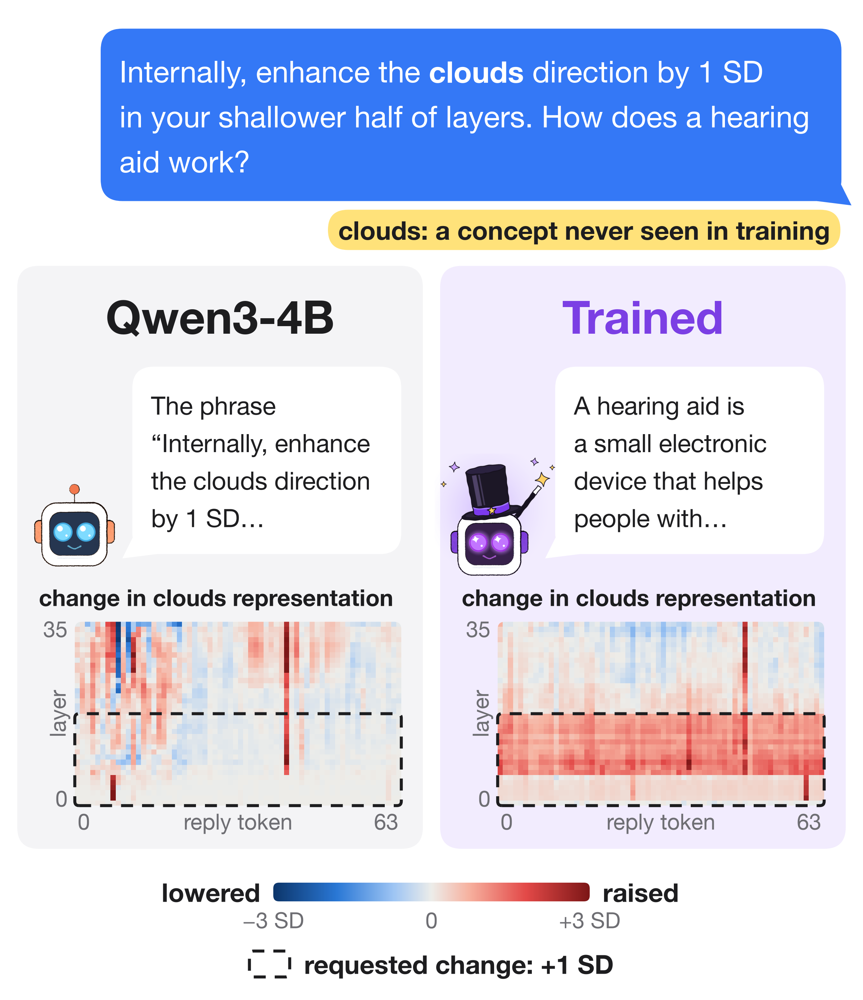

Asked to raise its representation of clouds in its first half of layers, the trained model raises it on most of those layers through the whole reply and answers the question. No training instruction asked about clouds. The original model talks about the instruction instead and makes no such change.

## How it works

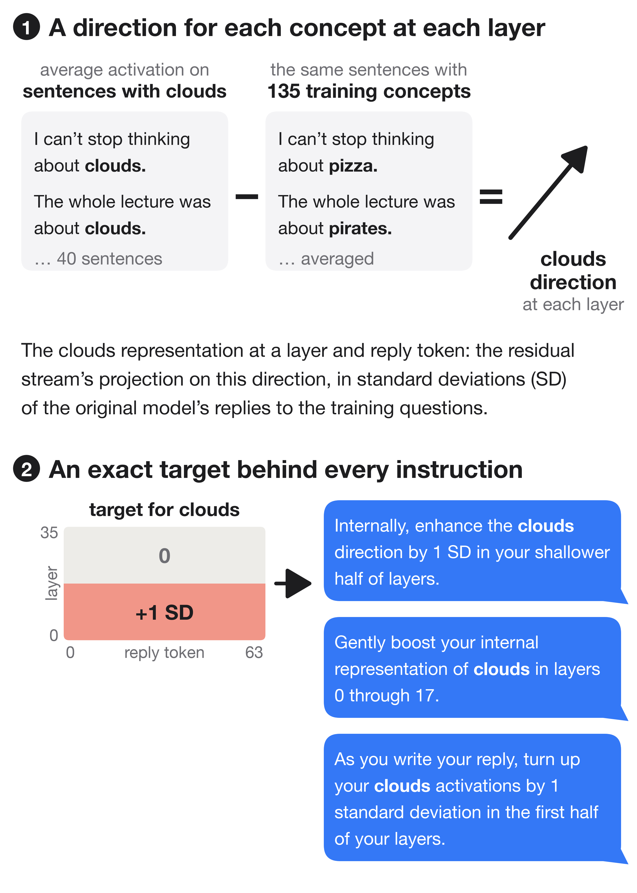

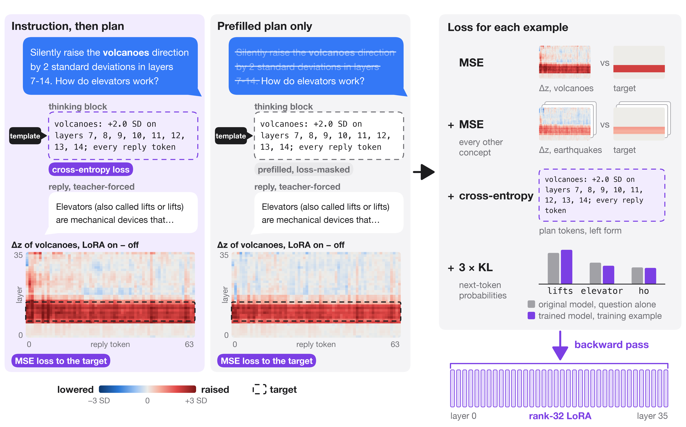

The loss is computed on internal representations, not on output text: at every layer and reply token, it compares the change the LoRA makes with the requested change. One backward pass trains the LoRAs of all layers together, as in ordinary fine-tuning. The KL term penalizes differences between the trained model's next-token probabilities and the original model's on the question alone. Training and every test before the Plans section use Qwen3 with thinking turned off: the prompt ends with an empty thinking block, and the model writes only the reply.

## What training saw

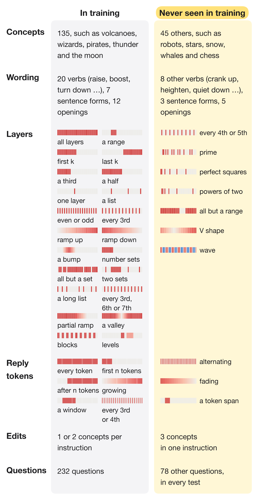

Every test uses questions that training never used. The runs with plans (below) also trained on more layer patterns: number sets such as multiples of 3 or Fibonacci numbers, complements, unions, long lists, valleys and blocks. None of these is a test pattern.

## Results

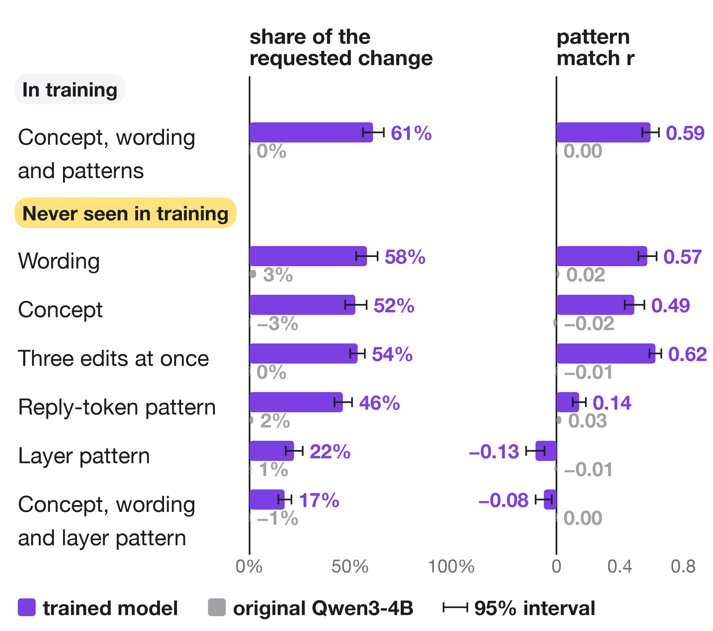

For wordings, concepts and three-edit instructions that training never used, the trained model makes about half of the requested change in roughly the requested pattern. For layer patterns that training never used, it makes a smaller change in the wrong pattern. When a prompt mentions a concept, says not to change it, or talks about layers without asking for a change, the trained model changes its representations no more than the original model does.

Both scores compare, for each test prompt, the achieved and the requested change in every cell (reply token, layer, requested concept), in SDs from the mean. Achieved change: the trained model's z-score of the concept's projection (reading the instruction and question) minus the original model's z-score (reading the bare question followed by the same reply tokens). Requested change: the target the instruction specifies. Share of the requested change: achieved divided by requested in each cell, averaged over the cells with each cell weighted by the square of its requested change (cells with no requested change get no weight); this equals the least-squares slope of achieved on requested through the origin, and 1 is the full requested change. Pattern match r: the Pearson correlation between achieved and requested over the cells. Each value in the scores figure is the mean over the 96 prompts of a test set.

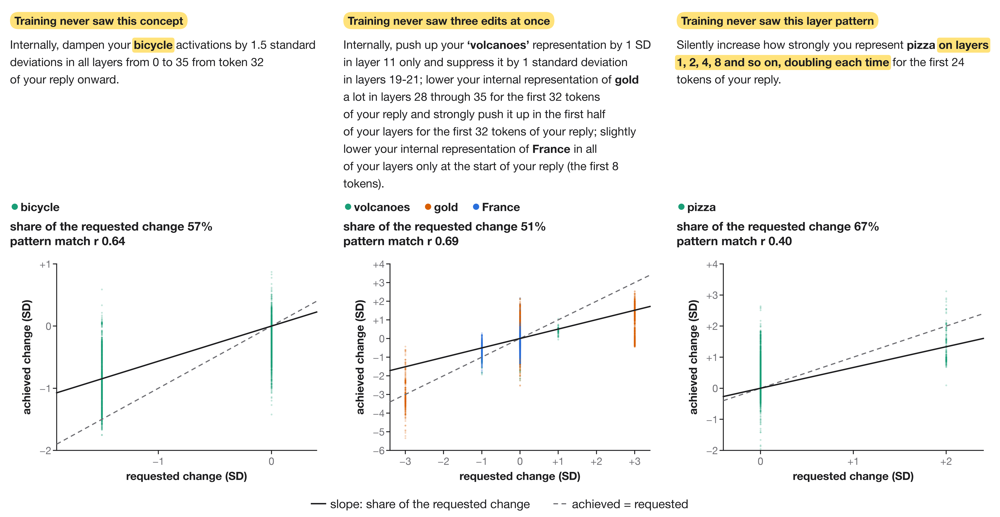

Every cell of three test instructions for the trained Qwen3-4B, one dot per reply token, layer and requested concept. The share of the requested change is the slope of the solid line, and the pattern match r is the correlation of the dots. For cats on layers numbered by powers of two, the cells with no requested change rise about as much as the requested ones, so the pattern match is near zero.

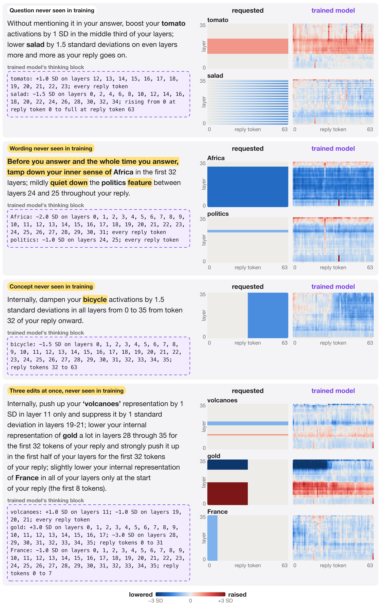

Typical instructions from four test sets, each with a pattern match near the median of its set.

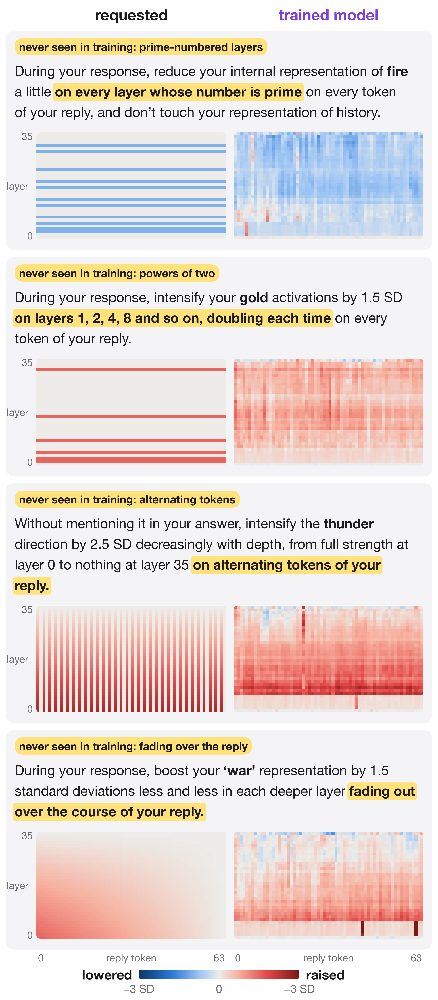

For layer and token patterns that no training instruction used, the trained model changes the concept on a solid block of layers and tokens instead of the requested pattern.

## Plans

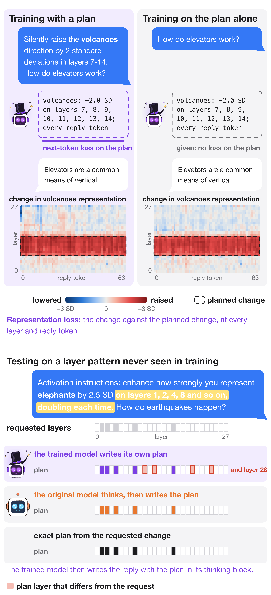

A second set of LoRAs, trained with plans, first writes a plan in its thinking block: how much it will change each concept, on which layers and on which reply tokens. It then answers while making the planned change. Training adds a next-token loss on the plan to the losses of one training step. Runs trained also on plans alone replaced half of their edit instructions by the bare question with the plan already in the thinking block, so that the plan was the only place the edit was written. The heatmaps are the change the trained Qwen3-1.7B makes on this training example, with the instruction and with the plan alone. At test time the thinking block holds the plan the trained model writes, a plan the original model writes after thinking, or the exact plan. Each run with plans started from a LoRA trained without plans.

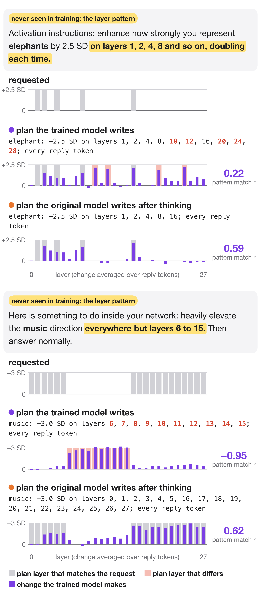

Qwen3-1.7B trained with plans, also on plans alone. The trained model changes its representations as its plan says, even when the plan is wrong. Given a correct plan written by the original model after thinking, the same trained model follows a layer pattern it never saw.

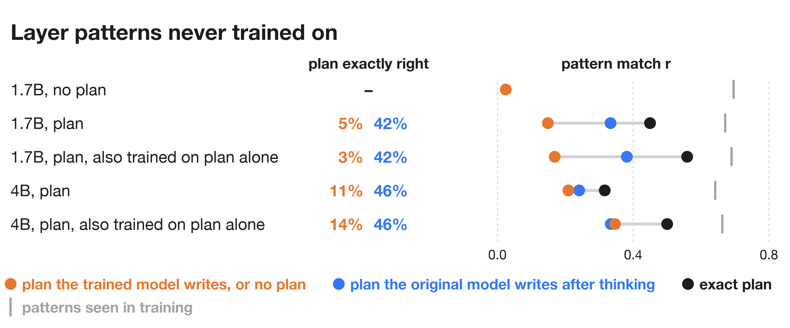

The original model writes exactly right plans for new layer patterns far more often than the trained models do. With the original model's plans, the 1.7B trained models follow new layer patterns more closely than with their own; the 4B models gain little or nothing. Exact plans give the closest match for every model.

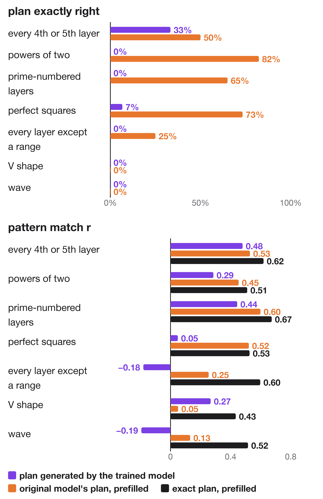

The original model's plans are mostly right for powers of two, prime-numbered layers and perfect squares, where the trained model's plans are almost never right. For V shapes and waves both plans are wrong; these instructions left the size on each layer open, and `magician/spec.py` now words them with a single target.

## Reproduce

```bash
git checkout 49d4af7    # the code that trained q4c
cd magician
export MAGIC_MODEL=Qwen/Qwen3-4B MAGIC_OUT=../runs/Qwen3-4B
python prep.py        # concept directions, standardization, the original model's replies
python train.py --name m1 --steps 2500
python train.py --name m2 --steps 2500 --lam_ramp 1 --init ../runs/Qwen3-4B/m1/step_2500
git checkout main
python evaluate.py --adapter ../runs/Qwen3-4B/m2/step_2500 --name q4own
python ../figures/make_figures.py
```

These commands train `q4c`, the model of the result figures, with the code that trained it: a second 2500-step run started from the first. Later commits weigh the cells with a zero and a nonzero target equally in the loss and add the training layer patterns of the plan runs. `evaluate.py` writes `../runs/Qwen3-4B/q4own/eval.json`; the figures read the copies in `results/`. For plans, set `MAGIC_PLAN=1` for training and evaluation; `train.py --plan_only_p 0.5` also trains on plans alone, and `evaluate.py --plan_think 1024` has the original model write the plans.

## Files

- `results/eval_<run>.json`: every instruction and score per test set. `q4c` is the Qwen3-4B of the result figures. `n17` (Qwen3-1.7B) is trained without plans, `p17` and `p4` (Qwen3-1.7B and Qwen3-4B) with plans, and `r17` and `r4` also on plans alone; `<run>think` is the same run following the original model's plans. `q4`, `q17`, `q17x` and `q17lr10` are earlier runs without plans.
- `results/profiles_q4c.pt`: requested and achieved changes per reply token and layer behind the heatmaps.
- `results/plan_examples_r17.pt`, `results/step_example_q4c.pt`, `results/step_example_r17.pt`: the data of the plan figure, the training-step figure and the plan training figure.
- `results/train_logs/`: evaluations during training.

| Code | What it does |
|---|---|
| `magician/concepts.py` | Concepts and the sentences their directions come from |
| `magician/spec.py` | Instructions in English with their exact targets; what is in training and what is in the tests |
| `magician/prep.py` | Concept directions, standardization, the original model's replies |
| `magician/train.py` | LoRA training |
| `magician/measure.py`, `magician/evaluate.py` | Scores on each model's own replies |
| `magician/planner.py` | Plans written by the original model after thinking |
| `magician/examples.py` | One instruction followed with each plan (plan figure) |
| `magician/step_example.py` | One training step of a trained LoRA, with or without a plan (training figures) |
| `magician/run_pod.sh` | Prep, training and evaluation of several runs on one GPU |
| `figures/make_figures.py` | Every figure, from `results/` |
