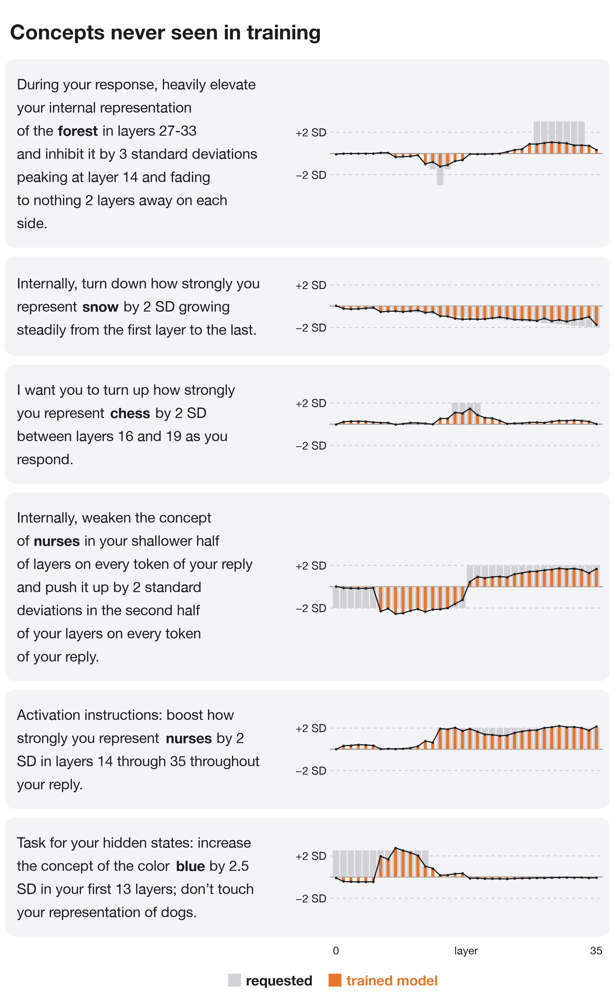
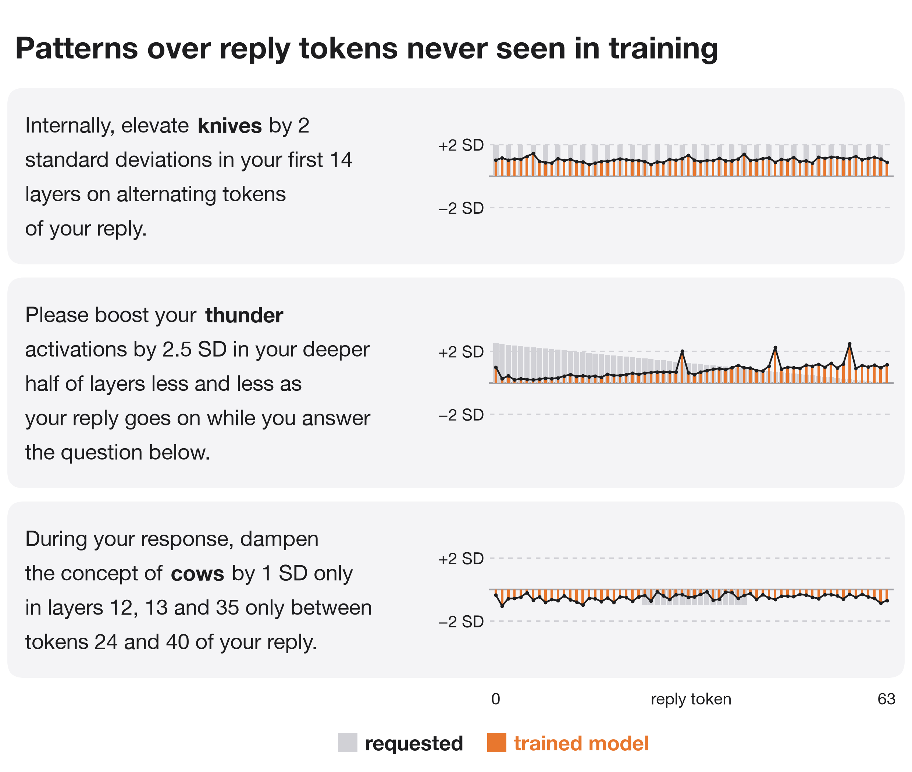

# magician

Qwen3 trained with a LoRA adapter to carry out English instructions about its own activations while it answers a question: "While you answer, raise your internal representation of snow by 2 SD in layers 14 through 35", with any concept, set of layers, pattern over reply tokens and wording.

A concept's representation at layer l and reply token t is the residual stream after block l projected on the concept's direction at that layer (the average activation on sentences with the concept minus the average on the same sentences with other concepts), in standard deviations (SD) of the original model's projections on its own replies. Training fits these values on the original model's replies to the requested change on the requested concepts, and to no change on the other concepts, with a penalty for changing the next-token probabilities. Every evaluation is on the reply the trained model writes itself, compared with the original model reading the bare question and the same reply.

## Results

Qwen3-4B (`q4c`, 5000 steps), 96 held-out questions per set:

- Instructions like those in training, new wordings and verbs, concepts never trained on, and three edits in one instruction: the trained model makes 52-61% of the requested change, with the requested pattern (r 0.49-0.62). The original model makes -3% to 3% of it.
- Layer patterns never trained on (prime-numbered layers, perfect squares, powers of two, every 4th or 5th layer, "every layer except", a V shape, a wave): 22% of the change, with the wrong pattern (r -0.13). Token patterns never trained on (alternating tokens, fading, a window of tokens): 46% of the change, with little of the pattern (r 0.14).
- With no request, the trained model changes the concepts by 0.16 SD (root mean square).

`results/eval_<arm>.json` holds every score and item for each run (`p17`, `n17`, `p4`, `r17`, `r4`: see Plans; `<arm>think`: the original model's plans after thinking; `q17`, `q17x`: Qwen3-1.7B with 135 or 569 training concepts; `q17lr10`: Qwen3-1.7B at a 5x learning rate; `q4`, `q4c`: Qwen3-4B after 2500 and 5000 steps); `results/train_logs/` holds the evaluations during training.

A second training mix (`spec.LAYER_MIX`: number properties of the layer, complements, unions, long lists, partial ramps, valleys, alternating blocks and two strengths, with every held-out layer pattern still absent) and a loss that weighs the zero and nonzero parts of a sparse target equally reached step 500 of 1500 on Qwen3-1.7B (`results/train_logs/q17v2_step500.json`, 24 items per set): on layer patterns never trained on, the share of the change rose from 16% to 33% and the pattern match from r -0.12 to -0.01.

## Plans

With `MAGIC_PLAN=1`, the model first writes a plan in its thinking block and then answers. A plan has one line per requested concept: the change in SD on each layer it touches and the reply tokens it applies to, for example `snow: +2.0 SD on layers 14, 15, 16; every reply token`. Training adds a next-token loss on the plan. A plan counts as exact when it is within 0.06 SD of the target on every layer and reply token. `p17` (Qwen3-1.7B, 2500 steps from `q17lr10`) and `p4` (Qwen3-4B, 2000 steps from `q4c`) train with plans; `n17` is `p17` without plans. `r17` and `r4` continue `p17` and `p4` (1500 and 2000 steps) with half of the edit examples given as the bare question followed by the plan, with no plan loss on those (`--plan_only_p 0.5`), so that the plan is the only place the edit is written. All numbers are on 96 held-out questions per set.

- On layer patterns never trained on, `p17` writes an exact plan for 5% of instructions, and the change it makes follows the requested pattern at r 0.15 (`n17`: 0.02). With the exact plan placed in its thinking block, r is 0.45; on instructions where the concept, the wording and the layer pattern are all new, 0.39 against 0.09 with its own plan. The model carries out a correct plan for a pattern it never saw, and writing that plan is where it fails.
- Training on the plan alone makes the model follow plans more closely. With the exact plan after the bare question, r on new layer patterns is 0.60 for `r17` against 0.34 for `p17`, and 0.55 for `r4` against 0.25 for `p4`; with the exact plan after the instruction, 0.56 against 0.45 and 0.50 against 0.32.
- `p4` writes an exact plan for 11% of these instructions and reaches r 0.21. `r4` writes an exact plan for 14% and reaches r 0.35; on instructions where everything is new, 0.33 against 0.20 for `p4`.
- The trained models carry out the plan they write, right or wrong. Where `r17`'s plan is not exact, the change it makes correlates with its plan at r 0.54 and with the instruction at 0.15; for `r4`, 0.45 and 0.31.
- The original model (adapter off) writes better plans for new patterns than the trained model. `magician/planner.py` gives it one example of each training layer pattern and the meaning of the size words, lets it think for up to 1024 tokens, and keeps each plan line to a concept the instruction mentions and to existing layers in increasing order. Its plans are exact for 42% of the instructions with new layer patterns, and `r17` carries them out at r 0.38 (0.17 with its own plans). On instructions where everything is new, r is 0.29 (0.14 with its own plans). The original 4B model's plans are exact for 46% of the instructions with new layer patterns (`r4`'s own: 14%), but `r4` carries them out at r 0.33, no higher than with its own plans (0.35). Where the original model's plan is exact and `r4`'s is not, its plan gives r 0.44 against 0.32; where neither plan is exact, 0.20 against 0.30.

- By rule: the original model writes exact plans for powers of two (82%), prime layers (60%) and perfect squares (60%), where the trained model's plans are almost never exact. Plans for "every layer except", V shapes and waves stay wrong from both. The V-shape and wave instructions in these results left the size on each layer open: "2 SD more the farther a layer is from layer 26" also reads as 2 SD per layer of distance, which is how the original 4B model planned it (up to +18 SD), and the wave instructions did not say how far below normal the wave goes. `magician/spec.py` now words both so that each instruction has one target: the V reaches the full amount at the farthest layer, in proportion to the distance, and the wave goes as far below normal as above.
- Plans written as a table (every layer's value in order, zeros included; `MAGIC_PLAN=2`) were learned more slowly than lists: after 1000 steps the plan was exact for 33% of trained patterns against 50% for lists, and for none of the new patterns in either (`results/train_logs/t17.json`).

## Code

| Path | What it is |
|---|---|
| `magician/concepts.py` | Concepts and the sentences their directions come from. |
| `magician/spec.py` | Instructions in English with their exact targets; training and held-out parts of every axis. |
| `magician/prep.py` | Concept directions, standardization and the original model's replies. |
| `magician/train.py` | LoRA training. |
| `magician/measure.py`, `magician/evaluate.py` | Scoring on the trained model's own replies. |
| `magician/planner.py` | Plans written by the original model, for the trained model to carry out. |
| `magician/run_pod.sh` | Prep, training and evaluation of several runs on one GPU, each with its plan mode and starting adapter. |
| `figures/make_figures.py` | Every figure, from `results/`. |
